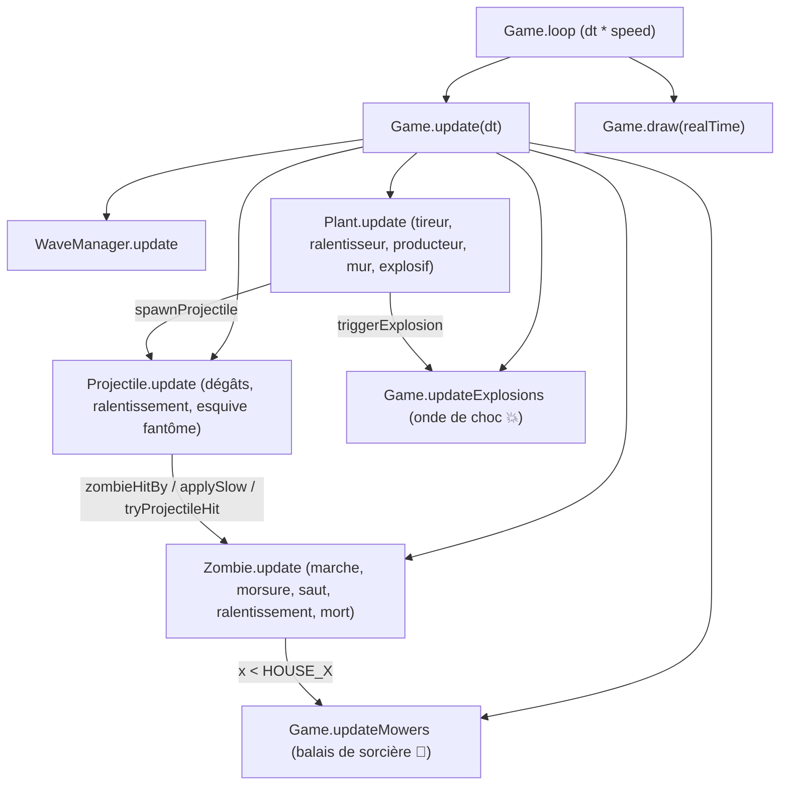

# Documentation complète — Partie A : Moteur et Gameplay (`src/engine/`)

Cette documentation détaille l'ensemble des ajouts réalisés sur la branche `gameplay` pour le **Rôle A (Moteur et gameplay)** définis dans `TACHES.md`, ainsi que les contrats d'intégration avec les rôles **B** (Interface), **C** (Contenu/Assets) et **D** (Game Design / JSON).

> [!IMPORTANT]
> Toutes les modifications du code source sont strictement isolées dans `src/engine/` afin d'éviter tout conflit Git lors de la fusion avec les branches de B, C et D.

---

## 1. Vue d'ensemble de l'architecture et des fichiers modifiés



| Fichier | Rôle et modifications principales |
|---|---|
| `src/engine/game.js` | Gestion de la vitesse `x2` (`toggleSpeed`, `setSpeed`), balais de sorcière (`createMowers`, `tryTriggerMower`, `updateMowers`, `drawMowers`), explosions de zone (`triggerExplosion`, `updateExplosions`, `drawExplosions`), gel de zone (`triggerFreeze`), potions en cloche (`spawnLob`), améliorations (`chooseUpgrade`, copies `plantDefs` / `level` par partie). |
| `src/engine/upgrades.js` | Système d'amélioration roguelike (`UpgradeManager`) : tirage pondéré par rareté, application des effets `ajout` / `mult` / `fixe`. |
| `src/engine/entities/plant.js` | Animation de tir (`shootAnim`), prise en charge des nouveaux types `ralentisseur` (🕸️) et `explosif` (💣 avec compte à rebours d'1 s et gonflement). |
| `src/engine/entities/zombie.js` | Animation de mort (`dying`, chute + fondu sur `0.45 s`), effet de ralentissement (`applySlow`, `slowTimer`, halo visuel), comportements spéciaux `sauteur` (saut par-dessus la 1re plante) et `fantome` (intangible 1 tir sur 2). |
| `src/engine/entities/projectile.js` | Propriétés `slowDuration` et `slowFactor`, gestion de la traversée des zombies fantômes via `ignoredZombies`. |

---

## 2. Détail des fonctionnalités implémentées

### 2.1. Animation de mort des zombies 🔴
- **Fichier :** `src/engine/entities/zombie.js` (`Zombie`)
- **Fonctionnement :**
  - Quand `hp <= 0` dans `takeDamage`, le zombie passe à `dying = true` (au lieu de disparaître instantanément) et émet immédiatement l'événement `zombieDied` (pour le son et les particules de C).
  - Pendant `DEATH_DURATION` (`0.45 s`), le zombie ne marche plus, ne mord plus, et est ignoré par `hasZombieAhead` ainsi que `zombieHitBy` pour ne pas bloquer les projectiles destinés aux zombies derrière lui.
  - Dans `Zombie.draw`, son sprite bascule vers l'arrière (`ctx.rotate`) et s'efface progressivement (`alpha: 1 - t`).
  - Au bout de `0.45 s`, `this.dead = true` permet à `Game.update` de le purger de `state.zombies`.

### 2.2. Animation de « tir » sur les plantes tireuses 🔴
- **Fichier :** `src/engine/entities/plant.js` (`Plant`)
- **Fonctionnement :**
  - Lorsqu'une plante de type `tireur` ou `ralentisseur` tire un projectile, `this.shootAnim` est initialisé à `0.18 s` (`SHOOT_ANIM_DURATION`).
  - Dans `Plant.draw`, la taille de la plante suit une courbe sinusoïdale `scale = 1 + 0.24 * Math.sin(p * Math.PI)`, faisant grossir la citrouille/plante jusqu'à `+24 %` avant de reprendre sa taille normale.

### 2.3. Nouveau type de plante : `ralentisseur` (Toile d'araignée 🕸️) 🟠
- **Fichiers :** `plant.js`, `game.js` (`spawnProjectile`), `projectile.js`, `zombie.js`
- **Fonctionnement :**
  - Détecte les zombies sur sa ligne et tire des projectiles bleu glacé/toile (`#9be7ff` par défaut).
  - À l'impact, `zombie.applySlow(duration, factor)` applique un ralentissement pendant **3 secondes** (`dureeRalentissement ?? 3`) qui divise par 2 la vitesse de déplacement et de morsure du zombie (`facteurVitesse ?? ralentissement ?? 0.5`).
  - Un halo bleu est dessiné sous les pieds du zombie tant que `slowTimer > 0`.

### 2.4. Nouveau type de plante : `explosif` (Citrouille bombe 💣) 🟠
- **Fichiers :** `plant.js`, `game.js` (`triggerExplosion`)
- **Fonctionnement :**
  - Une fois posée, son compte à rebours `fuseTimer` démarre à **1 seconde** (`delaiExplosion ?? 1.0`).
  - Pendant cette seconde, la plante gonfle et clignote de plus en plus vite (`Plant.draw`).
  - À `fuseTimer <= 0`, `game.triggerExplosion(x, y, radius, damage)` inflige les dégâts (`degatsExplosion`) à tous les zombies situés dans le rayon (`rayonExplosion`, 140 px par défaut), affiche une onde de choc `💥` pendant `0.35 s`, et libère la case.

### 2.5. Nouveaux comportements de zombies : `sauteur` et `fantome` 🟠
- **Fichier :** `src/engine/entities/zombie.js` (`Zombie`)
- **Les deux variantes sont supportées simultanément dans le moteur :**
  1. **Zombie sauteur (`sauteur` 🦘)** :
     - Dès qu'il rencontre sa **première plante** (`blocking && this.canJump && !this.hasJumped`), il déclenche un saut de `0.5 s` en cloche (`jumpY = -Math.sin(t * Math.PI) * 55`) qui le fait atterrir derrière la plante (`blocking.x - 42`).
     - Il mange ensuite normalement toutes les plantes suivantes.
  2. **Zombie fantôme (`fantome` / `spectre` 👻)** :
     - Grâce à `tryProjectileHit()` et au `Set` `projectile.ignoredZombies`, **1 projectile sur 2** traverse le fantôme sans le blesser et continue sa course sur la ligne.
     - Visuellement, le fantôme devient plus transparent (`alpha: 0.42`) lorsqu'il s'apprête à esquiver le prochain tir.

### 2.6. Tondeuses / « Balais de sorcière » (🧹) 🟢
- **Fichier :** `src/engine/game.js` (`Game`)
- **Fonctionnement :**
  - En début de partie, un balai `🧹` est stationné à gauche de chaque ligne (`x = HOUSE_X + 12`).
  - Si un zombie atteint la maison sur une ligne où le balai est encore disponible (`state === 'idle'`), `tryTriggerMower(row)` empêche la défaite et lance le balai (`state = 'sweeping'`) à `440 px/s`.
  - Le balai élimine tous les zombies présents sur sa ligne jusqu'au bord droit de l'écran, puis passe à `state = 'used'`.
  - Si un autre zombie atteint la maison sur cette même ligne alors que le balai est `'used'`, `game.lose()` est appelé.

### 2.7. Bouton vitesse x2 🟢
- **Fichier :** `src/engine/game.js` (`Game`)
- **Fonctionnement :**
  - `game.toggleSpeed()` bascule entre `1` et `2`, met à jour `state.speed` et émet l'événement `speedChanged` (`{ speed }`).
  - Dans `Game.loop`, `dt` est multiplié par `state.speed ?? this.speedMultiplier ?? 1`.

---

## 3. Ajouts de la branche `Debug`

- **Plus de définitions de secours** : `DEFAULT_PLANTS` / `DEFAULT_ZOMBIES` ont été supprimés. Toutes les stats viennent de `data/` (format dans [donnees.md](donnees.md)). Le fantôme est maintenant dans `zombies.json`.
- **Nouveaux types de plantes** dans `plant.js` :
  - `gel` (🧊) : après `delaiGel`, appelle `game.triggerFreeze` qui immobilise les zombies du rayon (`zombie.applyFreeze`) et leur inflige `degatsGel` ;
  - `piege` (🪤) : s'arme en `delaiArmement`, puis devient invisible pour les zombies (`plant.isHidden`, ignoré par `plantBlocking`) et inflige `degatsPiege` au premier qui passe dessus ;
  - `lanceur` (🧪) : `game.spawnLob` lance une potion en cloche sur `firstZombieAhead`, avec éclaboussure.
- **Zombie sauteur** : lit aussi `"sauteur": true`, `dureeSaut` et `vitesseApresSaut`.
- **Améliorations** (`engine/upgrades.js`) : `WaveManager` appelle `upgrades.maybeOffer` avant chaque vague (sauf la 1re). La partie passe en `state.status = 'choosing'` et émet `upgradeOffer`. L'interface appelle `game.chooseUpgrade(id)`, puis la vague est annoncée. Les effets modifient `game.plantDefs` (une copie par partie), donc les plantes déjà posées en profitent.
- **Stats d'amélioration gérées** : tir en rafale (`projectilesParTir`), perforation, tir sur 3 lignes, brûlure (`zombie.applyBurn`), régénération, ronces, réduction de morsure, explosion à la mort, bonbon doré, ralentissement après le gel, piège réutilisable.
- **Événement** `plantUsed` : une bombe, un givre ou un piège qui a servi (au lieu de `plantDied`, réservé aux plantes mangées).

## 4. Commandes de test rapide (Console F12)

Pendant une partie, ouvre la console du navigateur (`F12`) pour tester chaque nouveauté :

```js
// Tester les nouvelles plantes sur la ligne du milieu (ligne 2)
game.placePlant('toile', 2, 1)
game.placePlant('bombe', 2, 4)
game.placePlant('givre', 2, 5)
game.placePlant('piege', 2, 3)
game.placePlant('chaudron', 2, 0)

// Tester les nouveaux zombies sur la ligne du milieu
game.spawnZombie('loup-garou', 2)
game.spawnZombie('fantome', 2)

// Tester le balai de sorcière sur la ligne 0
const z = game.spawnZombie('basique', 0); z.x = 85;

// Activer / désactiver la vitesse x2 (ou touche V)
game.toggleSpeed()

// Forcer l'arrivée de la vague suivante (et donc le choix d'amélioration)
game.waves.time = game.waves.waves[state.wave].temps - 1
```
